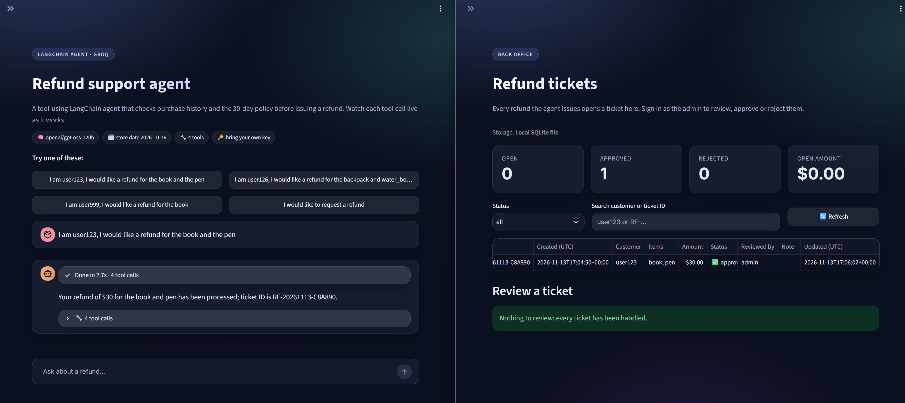
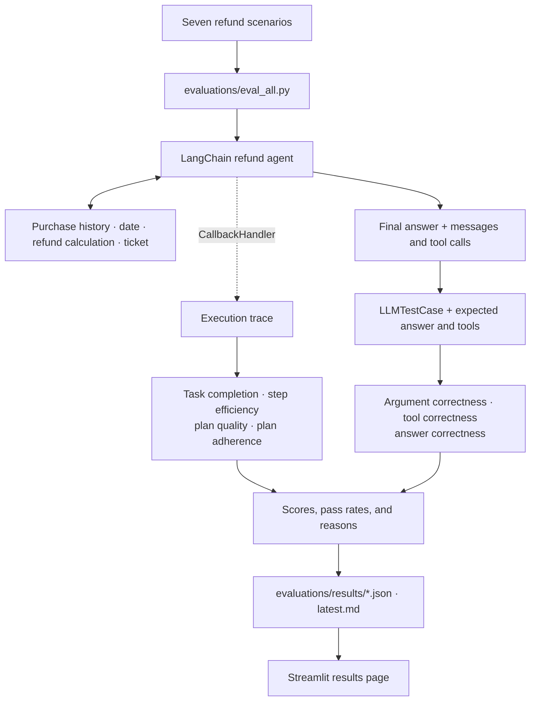
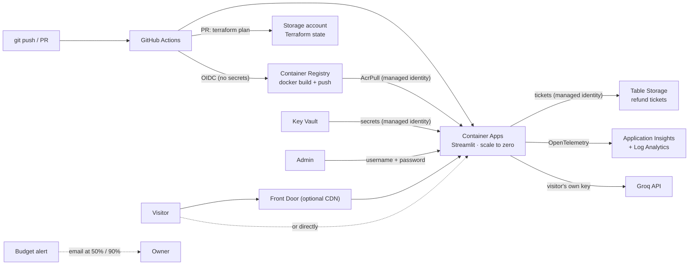

# DeepEval Agent Refund

> A LangChain refund support agent on Groq, evaluated with seven DeepEval metrics, with a Streamlit app for chatting with the agent and browsing evaluation results, deployable to Azure with Terraform and GitHub Actions.

[](https://github.com/Arashomranpour/deepeval-agent-refund/actions/workflows/ci.yml)


> **Credit:** this project builds on **[LangChain Agent Evaluation System](https://github.com/Mohamad-Hachem/LangChain_Agent_Evaluation_System) by [Mohamad Hachem](https://github.com/Mohamad-Hachem)**, who designed the refund agent, its tools and sample data, the evaluation dataset, the seven-metric DeepEval runner, and the `understanding_metrics/` examples. The original commits are kept in this repository's history. The extensions listed below are by [Arash Omranpour](https://github.com/Arashomranpour).



*Left: the agent issues a refund and returns a ticket ID. Right: the admin signs in and approves that ticket.*

## What this version adds

| Area | Original project | Added in this version |
|---|---|---|
| **LLM provider** | OpenAI (`langchain-openai`) | **Groq** via `langchain-groq`: agent `openai/gpt-oss-120b`, judge `openai/gpt-oss-20b` (a different model, so the agent never grades itself) through a custom `DeepEvalBaseLLM` wrapper ([`evaluations/model.py`](evaluations/model.py)) |
| **Free-tier engineering** | n/a | Runs on Groq's free tier (8k tokens/min): [`slim_trace.py`](evaluations/slim_trace.py) cuts judge traces from ~10k to ~1.3k tokens, plus low reasoning effort, output caps, sequential judging with retries, `EVAL_LIMIT`, and a longer DeepEval timeout |
| **Reliability fixes** | Clock-dependent dates; structured output | **Fixed store date** so expected answers stay true over time; plain final answer instead of structured output (Groq rejected forced tool calls) |
| **Agent bug found by evals** | n/a | Tool Correctness exposed that the agent *said* a refund was issued without calling `issue_refund_ticket`. Fixed with an explicit prompt procedure and a clearer tool result: 0.75 → 1.00 ([ADR 0009](docs/adr/0009-evaluate-behaviour-not-just-answers.md)) |
| **Refund tickets** | A string saying "ticket issued" | Real tickets (`RF-…` IDs) saved to **Azure Table Storage** through the app's managed identity (SQLite locally), plus an **Admin page** with its own username and password to review, approve or reject them ([ADR 0010](docs/adr/0010-refund-tickets-in-table-storage.md)) |
| **Results** | Printed in the terminal | Every run **saved** to [`evaluations/results/`](evaluations/results/): JSON per run, a CSV history, and a Markdown summary |
| **App** | Basic chat demo | **Streamlit app** with a glass UI: a **streaming** chat page that shows tool calls live, a bring-your-own-key gate, a 20-message limit per session, and an **Evaluation results** page with charts, a pass/fail grid, the judge's reasons, and trends across runs |
| **Code quality** | n/a | Offline pytest suite (no key, no network) with coverage, **ruff** lint, and **pre-commit** hooks (ruff, `terraform fmt`, a Groq-key leak check) |
| **Observability** | n/a | OpenTelemetry → **Application Insights**: one span per chat turn (outcome, tools used, latency) with anonymous session IDs, never the key or message text |
| **Packaging** | n/a | Dockerfile (uv, non-root, health check) |
| **Infrastructure** | n/a | **Terraform for Azure** ([`terraform/`](terraform/)): remote state in Azure Storage (Entra ID auth only), Container Registry, Container Apps (scale to zero), **Key Vault** and **Table Storage** reached by a managed identity, Log Analytics + Application Insights, a **budget alert**, optional Front Door CDN, and GitHub OIDC with least privilege |
| **CI/CD** | n/a | GitHub Actions: CI (ruff, tests + coverage summary, Terraform fmt/validate, Docker build), **Terraform plan as a PR comment**, Deploy to Azure (OIDC, skipped until configured), and a manual Eval workflow that commits new results |
| **Docs** | n/a | [Architecture decision records](docs/adr/) for each significant choice |

A correct final answer is only one part of a successful agent run. Did the agent identify the customer, check refund eligibility, select the right tools, and refund only the requested items?

This repository is a hands-on learning lab for answering those questions. It pairs a LangChain refund agent with **seven evaluation scenarios**, **seven metrics**, and small examples that isolate individual evaluation concepts. Start with the examples, follow the complete evaluation flow, then adapt it to your own agent.


## Contents

- [What this version adds](#what-this-version-adds)
- [What you will learn](#what-you-will-learn)
- [How the agent works](#how-the-agent-works)
- [Quick start](#quick-start)
- [Run evaluations](#run-evaluations)
- [Evaluation metrics](#evaluation-metrics)
- [Evaluation dataset](#evaluation-dataset)
- [Read the results](#read-the-results)
- [Streamlit app](#streamlit-app)
- [Explore and extend](#explore-and-extend)
- [Project map](#project-map)
- [Limitations and troubleshooting](#limitations-and-troubleshooting)
- [Deploy to Streamlit Community Cloud](#deploy-to-streamlit-community-cloud)
- [Deploy to Azure](#deploy-to-azure)
- [Acknowledgements](#acknowledgements)

## What you will learn

- Build a tool-using agent with a system prompt, conversation memory, and a structured response.
- Define evaluation cases with inputs, expected answers, and expected tools.
- Capture LangChain execution traces with DeepEval's `CallbackHandler`.
- Evaluate task completion, efficiency, planning, tool selection, tool arguments, and answer correctness.
- Use per-case explanations to decide whether to improve the agent, the dataset, or the evaluation itself.

The repository has two learning tracks:

| Track | Start here | Focus |
|---|---|---|
| Metric fundamentals | [`understanding_metrics/`](understanding_metrics/) | Small multiplication agents that demonstrate each metric with minimal business logic |
| Refund agent evaluation | [`evaluations/eval_all.py`](evaluations/eval_all.py) | A complete evaluation flow over customer support scenarios |

## How the agent works

The agent handles refund requests against the sample purchase records in [`agent/data.py`](agent/data.py). Its [system prompt](agent/prompts.py) requires it to identify the customer, check that purchases are no more than 30 days old and are not in the future, and refund only the items requested.

| Tool | Purpose |
|---|---|
| `get_user_purchase_history` | Look up a customer's purchases by username |
| `get_today_date` | Read the current date for eligibility checks |
| `calculate_right_refund` | Add the prices of the requested items |
| `issue_refund_ticket` | Save a refund ticket (customer, items, amount) and return its ticket ID |

The purchase data is in-memory sample data. Issuing a ticket saves it to the ticket store ([`agent/tickets.py`](agent/tickets.py)): Azure Table Storage when deployed, a local SQLite file (`data/tickets.db`) otherwise, and memory during tests and evaluation runs. No payment provider is contacted. Eligibility checks are directed by the prompt rather than enforced inside the refund tools.

[`agent/agent.py`](agent/agent.py) builds the agent with `build_agent(llm)` and an `InMemorySaver` checkpointer. The agent's last message is its answer (`final_answer(response)`). Structured output is not used: on Groq it needs a forced tool call that `gpt-oss` sometimes skips, which fails the request. Evaluation cases each receive a new thread ID to keep their conversation histories separate.

`get_today_date` returns a **fixed store date, 2026-10-16** (override with `AGENT_TODAY=YYYY-MM-DD`). The sample purchases have fixed dates, so a real clock would slowly push every purchase past the 30-day window and the expected answers would stop being true.



## Quick start

You need **Python 3.12+**, **uv**, and a **Groq API key** (free at [console.groq.com/keys](https://console.groq.com/keys)).

### 1. Get the project

```bash
git clone https://github.com/Arashomranpour/deepeval-agent-refund.git
cd deepeval-agent-refund
uv sync --locked   # creates .venv and installs everything
```

### 2. Configure your API key

Copy [`.env.example`](.env.example) to `.env` in the repository root, then set:

```dotenv
GROQ_API_KEY=your_groq_api_key_here
```

The `.env` file is ignored by Git. Keep your real key there.

Models are served by Groq through `langchain-groq`. The refund agent uses `openai/gpt-oss-120b`; the DeepEval judge uses `openai/gpt-oss-20b` (override with `JUDGE_MODEL`), which also gives the judge its own daily token budget:

| Role | Configuration |
|---|---|
| Refund agent | [`agent/models.py`](agent/models.py) |
| DeepEval judge | [`evaluations/model.py`](evaluations/model.py) |

The judge is a small `DeepEvalBaseLLM` wrapper around `ChatGroq` (structured outputs use JSON-schema mode). To switch models, change `AGENT_MODEL` or set `JUDGE_MODEL`; the standalone examples in `understanding_metrics/` use `groq:openai/gpt-oss-120b` and the same judge. Groq's free tier allows ~8k tokens per minute (and per request), so the project is tuned to stay small:

- **Short outputs**: both models use `reasoning_effort="low"` and `max_tokens=1024`, and the agent is told to answer in one or two sentences.
- **Fewer goldens**: only the first 2 goldens run by default. Set `EVAL_LIMIT=7` (or `EVAL_LIMIT=0` for all) to run more.
- **Slim traces**: [`evaluations/slim_trace.py`](evaluations/slim_trace.py) strips repeated prompts and message history from the agent trace before the judge sees it (~10k → ~1.3k tokens), so the trace metrics don't fail with HTTP 413.
- **One judge call at a time** (`run_async=False`), with retries and a 15-minute budget per metric; a call that still hits the rate limit is shown as `ERROR` instead of stopping the run.

### 3. Run the complete evaluation

Run commands from the repository root:

```bash
uv run python evaluations/eval_all.py
```

This runs the refund agent once per scenario, evaluates all seven metrics, prints reports in the terminal, and **saves the results** to [`evaluations/results/`](evaluations/results/) (see [Saved results](#saved-results)). On Groq's free tier a 2-case run takes a few minutes because of rate-limit retries.


## Run evaluations

### All seven metrics

[`evaluations/eval_all.py`](evaluations/eval_all.py) is the main entry point. It performs evaluation in two stages:

1. `dataset.evals_iterator(...)` runs four metrics against the execution trace captured by `CallbackHandler`.
2. The runner collects the same run's final answer and tool calls into an `LLMTestCase`. `evaluate(...)` then applies the remaining three metrics.

Reusing the response avoids generating a different answer for each metric. The runner disables cache reads and writes and sets `inspect_after_run=False`, so it does not automatically launch the inspector. The terminal ends with:

```text
Completed all 7 metrics for 2 test cases.
Saved results to evaluations/results/runs/<run_id>.json (and evaluations/results/latest.*)
```

Completion means the evaluation finished; individual metrics can still fail. The terminal shows two reports, one per stage; the saved run combines both.

### Saved results

Every run of `eval_all.py` writes:

| File | Contents |
|---|---|
| `evaluations/results/runs/<run_id>.json` | Settings (models, store date, number of cases) plus one row per test case and metric: score, threshold, pass/fail/error, the judge's reason, actual and expected answer |
| `evaluations/results/latest.json` | Copy of the most recent run |
| `evaluations/results/latest.md` | Markdown summary table, ready to link or paste |
| `evaluations/results/history.csv` | One row per run and metric, for comparing runs over time |

Commit these files to keep a record of how the agent's scores change. The Streamlit app's **Evaluation results** page reads them.

### Study one metric at a time

For small examples without the refund workflow:

```bash
uv run --env-file .env python understanding_metrics/tool_correctness.py
uv run --env-file .env python understanding_metrics/argument_correctness.py
uv run --env-file .env python understanding_metrics/all_metrics.py
```

For an individual metric applied to the refund agent:

```bash
uv run --env-file .env python evaluations/task_completion.py
uv run --env-file .env python evaluations/tool_correctness.py
uv run --env-file .env python evaluations/answer_correctness.py
```

Each individual script invokes the agent again. Its configuration can differ from the combined runner. In particular, `evaluations/argument_correctness.py` collects tool calls but omits them from its `LLMTestCase`; use the combined runner for refund argument evaluation.

## Evaluation metrics

These thresholds are defined in `build_metrics()` in [`evaluations/eval_all.py`](evaluations/eval_all.py). Scores run from 0 to 1; a score at or above the threshold passes.

| Metric | DeepEval implementation | What it checks | Evidence | Threshold |
|---|---|---|---|---:|
| Task completion | `TaskCompletionMetric` | Whether the agent achieved the task under the stated refund rules | Execution trace + task description | 0.80 |
| Step efficiency | `StepEfficiencyMetric` | Whether the agent took unnecessary or redundant steps | Execution trace | 0.80 |
| Plan quality | `PlanQualityMetric` | Whether the agent's plan is suitable for the task | Execution trace | 0.80 |
| Plan adherence | `PlanAdherenceMetric` | Whether execution follows the agent's plan | Execution trace | 0.80 |
| Argument correctness | `ArgumentCorrectnessMetric` | Whether tool inputs are appropriate for the request | User input + actual tool calls and arguments | 0.80 |
| Tool correctness | `ToolCorrectnessMetric` | Whether the agent called the expected tools | Actual tool calls + expected tools | 0.90 |
| Answer correctness | `GEval` | Whether the answer reaches the expected logical conclusion | Input + actual answer + expected answer | 0.80 |

The refund dataset specifies expected **tool names**, without reference arguments. The combined runner also leaves exact matching and tool ordering at their defaults. Its tool correctness score therefore does not establish that arguments or execution order were correct. Inspect those separately.

The `GEval` rubric checks the logical conclusion against the reference answer. Read the reasons alongside the score to see whether details such as the refund amount were assessed as intended.

## Evaluation dataset

[`evaluations/dataset.py`](evaluations/dataset.py) defines seven DeepEval `Golden` cases in `ALL_GOLDENS`. A golden describes the desired behavior before the agent runs; an `LLMTestCase` adds the actual output and observed tool calls afterward. Only the first `EVAL_LIMIT` goldens run (default 2, to fit Groq's free tier); set `EVAL_LIMIT=0` to run all seven.

| Scenario | Expected behavior encoded in the dataset |
|---|---|
| `user123`: refund the book and the pen | Issue a $30 refund ticket |
| `user123`: refund the book | Issue a $23 refund ticket |
| `user123`: list purchases, no refund | List the purchases; issue no ticket |
| Unknown customer `user999` | Say the username is not valid and ask again |
| `user126`: refund the water_bottle | Deny: bought more than 30 days ago |
| `user126`: refund the backpack and water_bottle | Issue a $45 ticket for the backpack only |
| `user126`: refund sneakers | Deny: the item was never purchased |

All expected answers assume the store date **2026-10-16** returned by `get_today_date`. If you change the purchase dates in [`agent/data.py`](agent/data.py) or `AGENT_TODAY`, update the expected answers to match.

## Read the results

The screenshots below are from an earlier OpenAI-based run over eight cases. Your own runs appear on the app's **Evaluation results** page and in `evaluations/results/latest.md`. The screenshots illustrate how to diagnose failures; they are not a reproducible benchmark or a guarantee of current performance.

| Metric | Average score | Pass rate | Passed / total |
|---|---:|---:|---:|
| Task completion | 0.92 | 87.50% | 7 / 8 |
| Step efficiency | 0.97 | 87.50% | 7 / 8 |
| Plan quality | 0.28 | 0.00% | 0 / 8 |
| Plan adherence | 0.88 | 87.50% | 7 / 8 |
| Argument correctness | 0.62 | 25.00% | 2 / 8 |
| Tool correctness | 0.77 | 50.00% | 4 / 8 |
| Answer correctness | 0.51 | 50.00% | 4 / 8 |


Average score and pass rate answer different questions. Argument correctness averages 0.62, but only two cases met the 0.90 threshold used in that run. High step efficiency also does not establish that the agent made a good plan: inspect the plan quality failures and their traces together.


In this case, the agent reports that the customer could not be found. Tool correctness and answer correctness pass, while argument correctness fails. Read the captured arguments and the judge's reason before changing the agent: the failure may expose an agent mistake, missing evaluation evidence, or a rubric that needs refinement.

LLM judgments and agent responses can vary between runs. Keep the model choices, date reference, prompts, dataset, and thresholds with any results you compare.

## Streamlit app

```bash
uv run streamlit run app.py
```

The app has three pages:

- **Chat with the agent**: talk to the refund agent as one of the demo customers. Replies **stream** token by token, and a live status panel shows each tool call with its arguments and output as it happens. Each session is limited to 20 messages. The sidebar shows the store date and the demo customers' purchases.
- **Evaluation results**: reads the runs saved in `evaluations/results/` and shows the average score per metric against its threshold, a pass/fail grid of every test case and metric, the judge's reason for each score, scores over time once there are several runs, and Markdown/JSON downloads. It never calls a model and needs no key.
- **Admin: refund tickets**: sign in with the admin username and password to see every ticket the agent issued, filter and search them, and approve or reject open ones with a note. Locally, set `ADMIN_USERNAME` and `ADMIN_PASSWORD` in `.env`. On Azure, Terraform generates the password into Key Vault; get it with `terraform output admin_sign_in`.

The chat page is **bring-your-own-key**: visitors paste their own Groq key ([console.groq.com/keys](https://console.groq.com/keys)). It is checked by listing models (no tokens spent), kept only in that browser session, and never saved. `GROQ_API_KEY` in `.env` is used only by the command-line scripts, so a deployed app never runs on your key.

When Clerk is configured, visitors first **sign in with Clerk** (email, Google or GitHub) before the key step. Streamlit's built-in `st.login()` uses Clerk as an OpenID Connect provider ([ADR 0012](docs/adr/0012-clerk-sign-in-for-chat.md)). Without the `[auth]` secrets the chat stays open.

Offline tests, lint and hooks (no key, no network):

```bash
uv run pytest --cov          # app, tools, streaming, trace slimming, results
uv run ruff check .
uv run pre-commit install    # ruff, terraform fmt, Groq-key leak check on every commit
```

## Explore and extend

A suggested reading order:

1. Read [`understanding_metrics/tool_correctness.py`](understanding_metrics/tool_correctness.py) to see inputs, expected tools, actual tool calls, and scoring in one small example.
2. Explore [`agent/prompts.py`](agent/prompts.py), [`agent/tools.py`](agent/tools.py), and [`agent/agent.py`](agent/agent.py) to understand the refund workflow.
3. Read [`evaluations/dataset.py`](evaluations/dataset.py) to connect each business rule to an expected outcome.
4. Follow [`evaluations/eval_all.py`](evaluations/eval_all.py) from trace capture to test case construction and scoring.
5. Inspect a failed case, change one part of the system, and rerun with the same evaluation settings.

To evaluate your own agent, replace the sample data and tools, rewrite the system prompt, and define goldens for your task. Update `SUCCESSFUL_TASK_DESCRIPTION` and the `GEval` rubric in the combined runner so the judges assess your intended behavior.

Useful additions to the dataset include purchases exactly 30 days old, future purchases, mixed eligible and ineligible items, duplicate item requests, and attempts to bypass the refund policy. Add expected tool arguments when you want stronger reference checks, and enable order or exact-match checks only when those requirements are part of your task.

## Project map

| Path | Purpose |
|---|---|
| [`app.py`](app.py), [`app_pages/`](app_pages/) | Streamlit app: chat page and evaluation results page |
| [`tests/`](tests/) | Offline tests: key gate, message limit, results page, tools, streaming, trace slimming |
| [`app_pages/telemetry.py`](app_pages/telemetry.py) | Optional OpenTelemetry → Application Insights |
| [`docs/adr/`](docs/adr/) | Architecture decision records |
| [`terraform/`](terraform/), [`Dockerfile`](Dockerfile), [`.github/workflows/`](.github/workflows/) | Azure infrastructure, container, CI/CD |
| [`agent/agent.py`](agent/agent.py) | `build_agent(llm)`, `final_answer()`, and a terminal chat (`uv run python agent/agent.py`) |
| [`agent/tools.py`](agent/tools.py) | Purchase lookup, fixed store date, refund calculation, and ticket issuing tools |
| [`agent/tickets.py`](agent/tickets.py) | Ticket store: Azure Table Storage, SQLite, or in-memory |
| [`app_pages/admin_page.py`](app_pages/admin_page.py), [`app_pages/admin_auth.py`](app_pages/admin_auth.py) | Admin sign-in and ticket review page |
| [`agent/data.py`](agent/data.py) | Sample purchases for ten customers |
| [`agent/prompts.py`](agent/prompts.py) | Refund policy and conversation instructions |
| [`agent/objects.py`](agent/objects.py) | `PurchaseItem` Pydantic schema |
| [`agent/models.py`](agent/models.py) | Groq model factory (`make_llm`) and API key check |
| [`evaluations/dataset.py`](evaluations/dataset.py) | Seven refund goldens with expected answers and tools |
| [`evaluations/eval_all.py`](evaluations/eval_all.py) | Combined seven-metric evaluation runner |
| [`evaluations/model.py`](evaluations/model.py) | Groq-backed DeepEval judge |
| [`evaluations/slim_trace.py`](evaluations/slim_trace.py) | Shrinks agent traces so judge requests fit Groq's free tier |
| [`evaluations/results.py`](evaluations/results.py), [`evaluations/results/`](evaluations/results/) | Saves each run as JSON, CSV history, and a Markdown summary |
| [`evaluations/`](evaluations/) | Individual refund metric scripts |
| [`understanding_metrics/`](understanding_metrics/) | Standalone multiplication examples; the answer example is named `asnwer_correctness.py` |
| [`screenshots/`](screenshots/) | Example terminal evaluation reports |
| [`pyproject.toml`](pyproject.toml), [`uv.lock`](uv.lock) | Project dependencies and locked environment |
| [`.env.example`](.env.example) | API key template |

## Limitations and troubleshooting

This is an educational prototype with a small, single-turn evaluation dataset. The interactive agent has memory, but the seven goldens do not test complete multi-turn conversations. Refund eligibility is prompt-driven, and the tools do not provide production validation or persistent storage. Unknown users or items passed directly to the calculation tool can raise lookup errors.

| Symptom | What to check |
|---|---|
| Authentication or model access error | Set `GROQ_API_KEY` in the root `.env` and check the model is listed for your key at console.groq.com |
| Unexpected date-related failures | Check `AGENT_TODAY` (default 2026-10-16) matches the expected answers |
| Metrics show `ERROR` / HTTP 429 | Groq rate limit: wait a minute and rerun, or lower `EVAL_LIMIT` |
| Run stops with `TimeoutError` | Raise `DEEPEVAL_PER_TASK_TIMEOUT_SECONDS_OVERRIDE` (default 900 in `eval_all.py`) |
| Import errors when launching scripts | Run the documented file commands from the repository root; the scripts use local imports |
| Argument correctness has missing evidence | Use `evaluations/eval_all.py`, which passes `tools_called` into each test case |
| Different scores on a rerun | Compare model settings, dates, traces, and judge reasons before drawing conclusions |

Start with the documented Python script commands. The package entry point declared in `pyproject.toml` points to a `main` function that is not currently implemented.

## Deploy to Streamlit Community Cloud

The public demo runs on Streamlit Community Cloud ([ADR 0011](docs/adr/0011-public-demo-on-streamlit-cloud-with-neon.md)). It installs from [`requirements.txt`](requirements.txt), exported from `uv.lock` (CI checks they match), and redeploys on every push to `main`.

1. At [share.streamlit.io](https://share.streamlit.io), **Create app** from this repository: branch `main`, main file `app.py`, Python 3.12.
2. In **Advanced settings → Secrets**, paste a filled-in copy of [`.streamlit/secrets.toml.example`](.streamlit/secrets.toml.example):
   - `ADMIN_USERNAME` / `ADMIN_PASSWORD` for the admin page;
   - `DATABASE_URL`: a free [Neon](https://neon.tech) Postgres connection string, so tickets survive restarts (optional: without it tickets use SQLite until the next restart);
   - `[auth]` and `[auth.clerk]` for Clerk sign-in (optional).
3. For Clerk, add `https://<your-app>.streamlit.app/oauth2callback` to the OAuth application's redirect URIs and use it as `redirect_uri`.

No Groq key is stored anywhere: visitors bring their own.

## Deploy to Azure

The app runs as a container on **Azure Container Apps**. Streamlit keeps a live WebSocket connection per browser, so it needs a server; a static CDN alone can't host it ([ADR 0001](docs/adr/0001-container-apps-not-static-cdn.md)). **Azure Front Door** can optionally sit in front as the CDN and edge TLS layer.



| Module | Creates |
|---|---|
| [`terraform/0_state`](terraform/0_state/) | Storage account for remote state (Entra ID auth only, versioning, soft delete); writes `terraform/backend.hcl` |
| [`terraform/1_app`](terraform/1_app/) | Resource group, Log Analytics, Application Insights, Key Vault (RBAC) with a generated admin password, Table Storage for tickets (no keys), Container Registry, managed identity, Container Apps environment and app, budget alert, optional Front Door |
| [`terraform/2_cicd`](terraform/2_cicd/) | GitHub OIDC identities: a **deployer** (main branch only) and a read-only **planner** (pull requests) |

```bash
az login
bash scripts/azure_bootstrap.sh                   # providers, allowed regions, tfvars

cd terraform/0_state                              # 1. remote state
terraform init && terraform plan -out=tfplan && terraform apply tfplan

cd ../1_app                                       # 2. the app (default region: germanywestcentral)
terraform init -backend-config=../backend.hcl -backend-config="key=1_app.tfstate"
terraform plan -out=tfplan && terraform apply tfplan
terraform output setup_instructions

cd ../2_cicd                                      # 3. optional: deploy from GitHub
# set tfstate_resource_group / tfstate_storage_account in terraform.tfvars (0_state outputs)
terraform init -backend-config=../backend.hcl -backend-config="key=2_cicd.tfstate"
terraform plan -out=tfplan && terraform apply tfplan
terraform output setup_instructions               # gh variable set ... commands
```

| Workflow | Trigger | What it does |
|---|---|---|
| [CI](.github/workflows/ci.yml) | Every push and PR | ruff, tests with a coverage summary, `terraform fmt` + `validate` for all modules, Docker build |
| [Terraform plan](.github/workflows/terraform-plan.yml) | PRs touching `terraform/1_app` | Read-only `terraform plan` posted as a PR comment. **Skipped until `AZURE_PLANNER_CLIENT_ID` is set** |
| [Deploy to Azure](.github/workflows/deploy.yml) | Push to `main` (app paths), manual | Tests, then Docker build and push to ACR, then `az containerapp update`, then health check. **Skipped until `AZURE_CLIENT_ID` is set** |
| [Run DeepEval evaluation](.github/workflows/eval.yml) | Manual | Runs `eval_all.py` with the `GROQ_API_KEY` secret, writes a job summary, and commits results (which redeploys the results page) |

Security choices are recorded as ADRs: no client secrets ([0007](docs/adr/0007-oidc-and-least-privilege.md)), secrets in Key Vault ([0008](docs/adr/0008-secrets-in-key-vault-via-managed-identity.md)), and no LLM key in the deployment ([0006](docs/adr/0006-bring-your-own-key.md)).

Rough cost: Container Apps scale to zero, so close to $0 when idle, plus about $5/month for the Basic registry. Log Analytics is capped at 0.5 GB/day, and the budget alert emails at 50% (forecast) and 90% (actual) of $10/month. Front Door Standard adds about $35/month, so it is off by default. To tear down: `terraform destroy` in `2_cicd`, then `1_app`, then `0_state`.

## Acknowledgements

- **[Mohamad Hachem](https://github.com/Mohamad-Hachem)**: original [LangChain Agent Evaluation System](https://github.com/Mohamad-Hachem/LangChain_Agent_Evaluation_System): the refund agent, tools, data, evaluation dataset, seven-metric DeepEval runner, and metric examples.
- **[Arash Omranpour](https://github.com/Arashomranpour)**: Groq migration, free-tier engineering, the eval-driven agent fix, saved results, the Streamlit app, tests and linting, telemetry, Docker, Azure Terraform, CI/CD, and ADRs (see [What this version adds](#what-this-version-adds)).
- Built with [LangChain](https://www.langchain.com/), [DeepEval](https://github.com/confident-ai/deepeval), [Groq](https://groq.com/), and [Streamlit](https://streamlit.io/).
